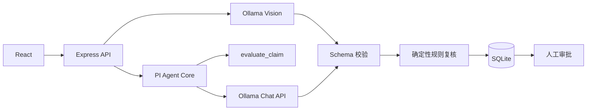

# ExpensePilot Agent

本地优先的企业费用审核系统。票据识别、规则检查和审核建议均由本机 Ollama 模型完成，报销数据无需发送到外部模型服务。

## 功能

- 识别票据金额、日期、币种、商户及中国发票关键字段
- 使用 PI Agent Core 调用白名单规则工具
- 通过 JSON Schema 和 Zod 约束模型输出
- 比较三个本地模型的审核质量与推理性能
- 对模型结论执行服务端规则复核
- 支持分级审批、审计记录和受保护的票据附件

模型只生成审核建议。通过、驳回和付款始终由具备权限的人员处理。

## 架构



Agent 只能读取报销快照并调用 `evaluate_claim`。服务端会在结果入库前核对建议、风险等级、缺失材料和检查项；模型不能调用审批或付款接口。

## 模型

| 任务 | 默认模型 | 选择依据 |
|---|---|---|
| 中文及通用票据识别 | `qwen3.5:4b` | 支持图像输入；中文发票关键字段严格准确率 97.4% |
| 文本审核 Agent | `qwen3:4b-instruct` | 两批评测的完整决策准确率均为 100% |
| 对照模型 | `phi4-mini:3.8b` | 用于质量、延迟和结构化稳定性比较 |

## 评测结果

评测共使用 **88 张公开数据集票据图片**，完成 88 个 OCR 任务和 264 个三模型 Agent 审核任务。

| 数据集 | 图片 | OCR 任务 | Agent 任务 | 主要用途 |
|---|---:|---:|---:|---|
| WildReceipt | 50 | 50 | 150 | 通用票据金额、商户、日期与全文识别 |
| PaddleOCR 增值税发票 | 38 | 38 | 114 | 中国发票关键字段识别 |
| **合计** | **88** | **88** | **264** | **共 352 个评测任务** |

三模型在两套数据上的 Agent 结果合并如下：

| 模型 | 结构化成功 | 完整决策正确 | 平均 / P95 延迟 | 格式修复触发率 |
|---|---:|---:|---:|---:|
| `qwen3:4b-instruct` | **88/88** | **88/88（100.0%）** | **37.61s / 45.75s** | **0.0%** |
| `phi4-mini:3.8b` | 87/88 | 81/88（92.0%） | 51.07s / 61.50s | 100.0%（成功样本） |
| `qwen3.5:4b` | 88/88 | 71/88（80.7%） | 66.32s / 70.48s | 1.1% |

OCR 指标按数据集分别计算：WildReceipt 的总金额严格准确率为 96.0%，中国增值税发票的价税合计、税额、发票号码和购买方名称严格准确率均为 97.4%。不同数据集的标注字段不同，不合并计算单一 OCR 准确率。

完整结果见[综合评测报告](docs/BENCHMARK_SUMMARY.md)，分项结果见[中国发票报告](docs/BENCHMARK_PADDLE_VAT_38.md)和[WildReceipt 报告](docs/BENCHMARK_WILDRECEIPT_50.md)。

## 快速开始

环境要求：Node.js 22.19+、pnpm 11+、Ollama、16 GB 以上内存。三模型对比按顺序执行，不要求三个模型同时驻留内存。

```powershell
ollama pull qwen3.5:4b
ollama pull qwen3:4b-instruct
ollama pull phi4-mini:3.8b

cd backend
pnpm install
Copy-Item .env.example .env
pnpm db:generate
pnpm db:push
pnpm db:seed
pnpm dev
```

另开一个终端启动前端：

```powershell
cd frontend
pnpm install
pnpm dev
```

浏览器访问 `http://127.0.0.1:5173`。首次运行前需要在 `.env` 中设置随机 JWT 密钥和本地演示密码。

## 配置

```dotenv
DATABASE_URL="file:./data/expense-pilot.db"
JWT_SECRET="replace-with-at-least-32-random-characters"
REFRESH_TOKEN_SECRET="replace-with-a-different-32-character-secret"
DEMO_SEED_PASSWORD="replace-with-a-local-demo-password"
OLLAMA_BASE_URL="http://127.0.0.1:11434"
OLLAMA_COMPARE_MODELS="qwen3.5:4b,qwen3:4b-instruct,phi4-mini:3.8b"
OLLAMA_DEFAULT_MODEL="qwen3:4b-instruct"
OLLAMA_VISION_MODEL="qwen3.5:4b"
OLLAMA_CONTEXT_LENGTH=8192
AGENT_MAX_TURNS=4
HOST="127.0.0.1"
PORT=3001
```

## API

| 方法 | 路径 | 用途 |
|---|---|---|
| `GET` | `/health` | 服务与模型状态 |
| `POST` | `/api/expenses/ocr` | 票据识别 |
| `GET` | `/api/expenses/:id/receipt` | 鉴权读取票据 |
| `GET` | `/api/agent/models` | 模型安装状态 |
| `POST` | `/api/agent/assess/:expenseId` | 默认模型审核 |
| `POST` | `/api/agent/compare/:expenseId` | 三模型对比 |
| `GET` | `/api/agent/assessments/:expenseId` | 历史结果与指标 |

Agent 接口仅限管理员访问。

## 验证

```powershell
cd backend
pnpm test
pnpm typecheck
pnpm build

cd ../frontend
pnpm build
```

## 文档

- [综合评测结果](docs/BENCHMARK_SUMMARY.md)
- [评测方法](docs/EVALUATION.md)
- [中国增值税发票基准](docs/BENCHMARK_PADDLE_VAT_38.md)
- [WildReceipt 50 张票据基准](docs/BENCHMARK_WILDRECEIPT_50.md)
- [外部数据集](backend/benchmarks/datasets/README.md)
- [贡献指南](CONTRIBUTING.md)
- [安全策略](SECURITY.md)

## 数据与部署

`.env`、数据库、票据附件、模型权重、外部数据集和逐条评测结果均被 Git 忽略。仓库中的账号、邮箱、商户和报销记录为合成演示数据。

当前 SQLite 与本地附件存储适合单机演示。多实例部署需要接入生产数据库、对象存储、TLS、集中审计和企业审批策略。基准数据不包含真实欺诈结论，相关指标仅用于票据字段提取和规则执行评估。
