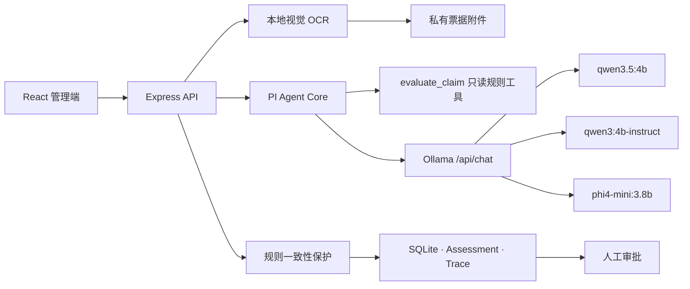

# ExpensePilot Agent

本地优先的企业报销审核 Agent。项目将票据视觉识别、确定性政策工具、PI Agent 工具调用、三模型评测和人工审批组合成一条可追踪的业务链路。模型只提供审核建议，不具备通过、驳回、付款或修改报销状态的权限。

> 项目用于 Agent 工程实践与本地评测，不是可直接用于生产财务系统的成品。仓库中的公司、用户、邮箱、商户、IP 和报销记录均为合成演示数据。

## 核心能力

- **本地模型推理**：通过 Ollama 运行视觉与文本模型，票据图片无需发送到外部大模型服务。
- **受控 Agent 循环**：模型必须调用一次只读 `evaluate_claim` 工具，工具结果回灌后才能生成最终审核说明。
- **确定性政策边界**：金额、日期、币种、类别、票据、商户、说明和高额阈值由服务端代码计算。
- **结构化与修复**：最终输出通过 Zod/JSON Schema 校验，格式失败时最多修复一次。
- **生产一致性保护**：模型遗漏检查项或弱化风险时，服务端使用可信规则结果校正并记录 Guardrail Trace。
- **Human-in-the-loop**：`human_review_required` 始终为 `true`，最终审批仍由授权用户执行。
- **可观测性**：记录 TTFT、总延迟、Token/s、工具调用、修复次数、模型加载时间和事件 Trace。
- **可复现评测**：真实票据评测固定数据源哈希、采样种子和模型配置，支持逐条落盘及断点续跑。

## 系统架构



### 一次审核的执行顺序

```text
票据上传与签名校验
→ 自动旋转、压缩和本地 OCR
→ 用户确认字段并提交报销
→ Agent 读取只读报销快照
→ 调用确定性规则工具
→ 工具结果回灌模型
→ Schema 校验与一次修复
→ 服务端规则一致性校验
→ 保存审核结果、指标和 Trace
→ 人工审批
```

## 模型职责与正式评测

2026-08-31 使用 WildReceipt 官方 test split 中按 `seed=20260831` 确定性抽取的 50 张真实场景票据完成评测：50 次 OCR，加上三个模型各 50 次 Agent 审核，共 200 次本地推理。

### OCR

| 指标 | 结果 |
|---|---:|
| 结构化成功 | 50/50 |
| 总金额严格准确率 | 96.0% |
| 总金额 1% 容差准确率 | 98.0% |
| 商户包含匹配率 | 88.0% |
| 日期准确率 | 76.5%（34 条有真值） |
| 全文字符错误率 CER | 12.7% |
| 平均 / P95 延迟 | 82.56s / 229.43s |

### Agent

| 模型 | 结构化成功 | 完整决策准确率 | 检查覆盖率 | 平均 / P95 延迟 | Schema 修复率 |
|---|---:|---:|---:|---:|---:|
| `qwen3.5:4b` | 50/50 | 80.0% | 100.0% | 61.76s / 66.89s | 0.0% |
| `qwen3:4b-instruct` | 50/50 | **100.0%** | 84.3% | **38.44s / 46.74s** | **0.0%** |
| `phi4-mini:3.8b` | 50/50 | 92.0% | 80.3% | 53.30s / 61.50s | 100.0% |

默认使用 `qwen3:4b-instruct` 执行文本审核，`qwen3.5:4b` 负责视觉票据提取。离线报告保留 Guardrail 校正前的模型表现，不使用保护层美化模型指标。

完整协议与结果：

- [评测规范](docs/EVALUATION.md)
- [50 张真实票据评测结论](docs/BENCHMARK_WILDRECEIPT_50.md)
- [外部数据集说明](backend/benchmarks/datasets/README.md)

## 技术栈

| 层级 | 技术 |
|---|---|
| Agent | PI Agent Core 0.84.2、Ollama Native Chat、Tool Calling |
| 后端 | Node.js、TypeScript、Express、Zod、Prisma |
| 前端 | React、Vite、TanStack Query、Zustand、Tailwind CSS |
| 图像 | Sharp、Ollama Vision |
| 数据 | SQLite（本地演示）、私有文件附件 |
| 工程 | pnpm、Node Test Runner、GitHub Actions |

## 本地运行

### 1. 环境要求

- Node.js 22.19+
- pnpm 11+
- Ollama
- 建议至少 16 GB 内存；三个模型顺序执行，不要求同时常驻

### 2. 准备模型

```powershell
ollama serve
ollama pull qwen3.5:4b
ollama pull qwen3:4b-instruct
ollama pull phi4-mini:3.8b
```

### 3. 启动后端

```powershell
cd backend
pnpm install
Copy-Item .env.example .env
pnpm db:generate
pnpm db:push
pnpm db:seed
pnpm check:local
pnpm dev
```

`.env.example` 中的演示密码只用于本机合成数据，请勿在任何真实环境复用。Seed 用户使用保留域名 `.example`，不会对应真实邮箱。

### 4. 启动前端

```powershell
cd frontend
pnpm install
pnpm dev
```

访问 `http://127.0.0.1:5173`。Seed 完成后，终端会打印合成演示账号；密码取自本地 `DEMO_SEED_PASSWORD`。

## 关键配置

```dotenv
DATABASE_URL="file:./data/expense-pilot.db"
JWT_SECRET="replace-with-at-least-32-random-characters"
REFRESH_TOKEN_SECRET="replace-with-a-different-32-character-secret"
DEMO_SEED_PASSWORD="LocalDemo@1234"
OLLAMA_BASE_URL="http://127.0.0.1:11434"
OLLAMA_COMPARE_MODELS="qwen3.5:4b,qwen3:4b-instruct,phi4-mini:3.8b"
OLLAMA_DEFAULT_MODEL="qwen3:4b-instruct"
OLLAMA_VISION_MODEL="qwen3.5:4b"
OLLAMA_CONTEXT_LENGTH=8192
AGENT_MAX_TURNS=4
HOST="127.0.0.1"
PORT=3001
```

生产环境必须使用随机生成的独立密钥、正式数据库、集中式日志和企业批准的政策与汇率数据源。

## 数据与隐私

- `.env`、数据库、票据附件、下载的数据集、模型权重和原始评测结果均被 `.gitignore` 排除。
- 票据附件按用户和公司边界鉴权，不放在公开静态目录。
- 上传图片校验声明 MIME 与真实文件签名，单张限制为 10 MB。
- 报销文本和票据文字均作为不可信数据处理，不能改变 System Prompt 或调用非白名单工具。
- Seed 数据全部为合成内容，邮箱使用 `.example`，IP 使用文档保留网段。

## API 概览

| 方法 | 路径 | 说明 |
|---|---|---|
| `GET` | `/health` | 本地服务、Ollama 与模型状态 |
| `POST` | `/api/expenses/ocr` | 本地票据识别并保存私有附件 |
| `GET` | `/api/expenses/:id/receipt` | 鉴权读取票据附件 |
| `GET` | `/api/agent/models` | 三模型安装状态 |
| `POST` | `/api/agent/assess/:expenseId` | 默认模型审核 |
| `POST` | `/api/agent/compare/:expenseId` | 三模型顺序对比 |
| `GET` | `/api/agent/assessments/:expenseId` | 查询审核与指标历史 |

Agent API 需要管理员身份，模型结果不会直接调用审批路由。

## 评测复现

数据集二进制不包含在仓库中。下载脚本固定官方地址并校验 SHA-256：

```powershell
cd backend
pnpm dataset:wildreceipt
pnpm benchmark:real -- --limit=50 --phase=all --seed=20260831 --run-id=wildreceipt-real-50-v4
```

报告会生成到被忽略的 `backend/benchmarks/real/`。WildReceipt 没有业务类别或真实欺诈标签，因此项目不声称 category 准确率、欺诈召回率、误报率或 AUC。

## 验证

```powershell
cd backend
pnpm test
pnpm typecheck
pnpm build

cd ../frontend
pnpm build
```

CI 在每次 Push 和 Pull Request 时安装锁定依赖，并执行后端测试、类型检查、后端构建和前端构建。

## 项目结构

```text
backend/
  prisma/                         数据模型与合成 Seed
  scripts/benchmark-wildreceipt.ts 可恢复真实票据评测
  scripts/download-wildreceipt.ts  官方数据下载与哈希校验
  src/controllers/agent.controller.ts
  src/services/pi-agent.service.ts  Agent 循环、工具和 Guardrail
  src/services/ocr.service.ts       视觉 OCR 与图像预处理
  src/services/receipt-storage.service.ts
  test/pi-agent.test.ts
frontend/
  src/pages/admin/AgentLab.tsx      三模型实验台
  src/components/expense/           票据与报销交互
docs/
  EVALUATION.md
  BENCHMARK_WILDRECEIPT_50.md
.github/
  workflows/ci.yml
```

## 已知边界

- 本机 4B 模型适合原型与隐私场景，不代表云端大模型的能力上限。
- 真实评测样本以英文场景票据为主，不能替代中文增值税发票专项评测。
- SQLite 和本地附件存储只用于本地演示；多实例部署需要替换为生产级数据库与对象存储。
- Agent 是决策辅助系统，不是自动财务审批人。

## 贡献与安全

- 提交改动前请阅读 [CONTRIBUTING.md](CONTRIBUTING.md)。
- 安全问题请按照 [SECURITY.md](SECURITY.md) 使用 GitHub 私密漏洞报告，不要在公开 Issue 中提交票据或密钥。
